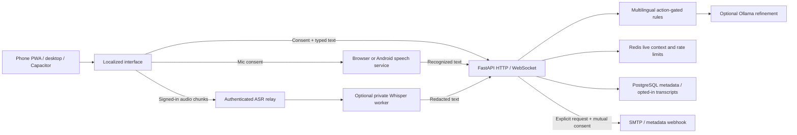

# Architecture

## Data flow

One same-origin server serves the frontend and API. The browser never receives provider credentials. Session cookies are HttpOnly/SameSite; production adds Secure. Mutation requests require the configured Origin and custom header. WebSockets validate origin and reauthenticate messages. Models receive redacted text with untrusted-input instructions and bounded evidence validation.

Live context uses a 30-minute sliding TTL. Redis provides shared state, counters and locks for deployed workers. SQLite/in-process state exists only for local development; production startup requires PostgreSQL, Redis and an HTTPS origin. Concurrent call updates are serialized, request IDs are deduplicated, and at most one high-risk warning is new per call.

Accounts, hashed login tokens, calls, accepted-contact relationships and delivery attempt status live in SQL. Transcript and evidence arrays remain empty unless the user opted in when starting a session. Session expiry is enforced on reads and by periodic cleanup; account deletion cascades rows and clears live call memory. Anonymous analytics retain event/day totals, not account identifiers.

## Model behavior

Shared severity weights are deliberately explainable. Urgency/authority alone remain low; high requires a credential, payment or remote-access request. Protective advice and reported speech are filtered. The optional model can add bounded, quoted contextual evidence but cannot clear rule findings; it is not a demonstrated precision improvement. Timeout or malformed output preserves Stage 1 and reports fallback. The current rules miss some paraphrases: inspect the evaluation misses before presenting performance claims.

## Legacy and migration

`backend/server.py`, `backend/storage.py`, `frontend/index.html`, `frontend/app.js` and their tests preserve v1 for reference. The default route serves `phone.html` and `/api/v2`; it does not run the legacy dashboard API. Product data uses separate `product_*` tables and `data/product.db`. Existing v1 records are not silently imported. There is no automated destructive migration.

The initial product schema is created from SQLAlchemy metadata. `database/002_product_postgres.sql` documents the fresh schema. Before any future schema change, add an explicit migration, rehearse it against a backup and define a restore plan; rolling back an image does not roll back a database.

## Extension points

Add a language with a registry entry, catalog, script font mapping, lexicon and independently authored tests. UI catalogs and lexicons require no engine changes. New script identification may require extending the optional script heuristic; selected-language detection already loads its configured pack. Network VoIP, OEM integration, additional message-provider adapters and independent language validation are future work.
