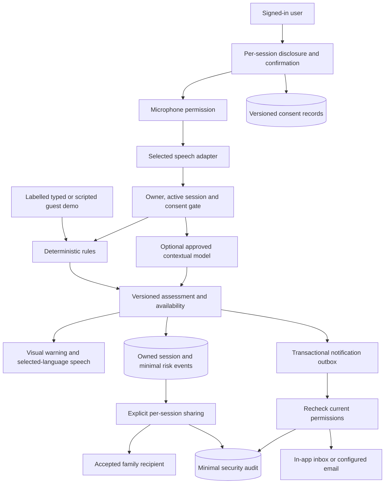

# Catchy AI: master specification implementation plan

Assessment updated 25 October 2026. This applies the supplied Antigravity specification to the existing repository. Proposed components below are not claims of completed functionality.

## Current repository and reuse

| Area | Existing foundation | Required extension |
| --- | --- | --- |
| Frontend | HTML/CSS/JavaScript modules, template-based responsive PWA, local fonts, localization, accessibility controls | Retain this stack. Add onboarding, a persisted dashboard, timeline, sharing and notification views. React/TypeScript migration does not solve the current safety gaps. |
| Backend | Python 3.11+, FastAPI, Pydantic, SQLAlchemy, REST/WebSockets | Retain and separate consent, sharing, notification and operations services as features are added. |
| Persistence | SQLite locally, PostgreSQL deployment configuration, Redis or bounded local temporary state | Keep SQLite for laptop demonstrations. Introduce reviewed upgrade migrations before schema expansion. Current SQL files and create_all are not migration tooling. |
| Identity | Password hashes, hashed eight-hour sessions, HttpOnly/SameSite cookies, origin/header checks, email verification and bounded reset codes | Add reviewed Google OIDC/linking, reset links, inactivity locking and administrator step-up authentication. |
| Analysis | Multilingual rules, redaction, optional OpenAI/Gemini/Ollama contextual adapters | Correct contextual false alarms and misses; introduce versioned categories, uncertainty, timeline and explicit fallback policy. |
| Speech | Browser recognition, Android bridge, optional self-hosted Whisper | Tie hosted audio to owned active sessions; validate real playback outcomes and actual device/language performance. |
| History | Ownership checks, latest score, opt-in redacted transcript, default 30-day expiry, deletion | Add transcript-free risk events, end time, monitoring gaps and sharing status. |
| Family | Verified invitation acceptance, bilateral alert consent, relationship revocation | Add invitation email, durable decline, per-session sharing and permission history. |
| Alerts | SMTP/webhook adapters with provider-acceptance semantics | Add transactional outbox, inbox, bounded retries, idempotency and permission rechecks. |
| Operations | Health, restricted metrics, content-free error reporting, evaluation administrator, CI/Docker/source packaging | Add migrations, minimal audit records, stronger admin authentication and tested recovery. |

Primary files: backend/product.py, backend/product_store.py, backend/detection.py, backend/notifications.py, llms/product.py, frontend/product.js, frontend/asr.js and frontend/api-client.js. Existing uncommitted work and user databases must be preserved. Handler tests with DOM stubs do not establish browser accessibility or audio quality.

## Proposed architecture and data flow

Recommended temporary baseline: retain the current stack, local SQLite, explicit rules-only demonstration, and mocked external services in ordinary tests. This is a reversible recommendation, not approval for a new paid service or production deployment.

This diagram is the target. Durable consent, risk events, sharing and outbox storage are proposed additions. No raw audio enters persistent application storage. Browser speech may send audio to its vendor; disclose this separately from backend model processing.

## Authentication and authorization design

- Retain same-origin cookie authentication, server-side ownership checks, origin/header protection and per-message WebSocket authentication. Production requires HTTPS/Secure cookies.
- Require sign-in, explicit new-session confirmation and an owned active session before microphone capture. Stop/withdrawal prevents new processing but cannot recall already transmitted provider requests.
- Keep guest typed/scenario demonstrations rules-only. Do not describe scripted results as microphone validation.
- Implement Google OIDC through an established reviewed library, including state/nonce/PKCE validation. Show the option only when configured. Link identities only after proof of control of the existing account; matching email alone is insufficient.
- Add hashed, expiring, single-use reset-link tokens. Retain enumeration-resistant responses and revoke sessions on successful reset. Preserve the current recovery flow until replacement tests pass.
- Check relationship acceptance, explicit share level, session expiry and transcript-retention permission on every shared read. Family relationships do not grant general history access or remote microphone control.
- Restrict administrators to operational metadata. Private-content emergency access remains disabled until step-up authentication, approval, justification, scope, duration and audit-review policy are resolved.
- Add inactivity locking, immediate private-screen clearing on sign-out even during an outage, and cross-account response guards. Disclose incomplete server revocation rather than leaving private history visible.

## Proposed schema and migrations

Introduce reviewed versioned migrations before adding these entities. Test fresh setup, upgrade from a synthetic current-schema database, preservation, foreign keys and recovery on SQLite and PostgreSQL. Never reset the user's database as a migration strategy.

| Entity | Minimum fields/purpose | Rule |
| --- | --- | --- |
| Existing User/Login/Call/Contact | Preserve stable identifiers and ownership | No automatic sharing or expanded role during upgrade |
| AuthIdentity | provider, subject, user, linked time | Unique provider/subject and proven account control |
| ResetLink | token digest, user, expiry, use time | Never store/log usable tokens |
| ConsentRecord | user/session, purpose/provider, notice version, grant/withdrawal times | Per-session scope and reviewed retention |
| RiskEvent | session, time, score/category, signal IDs, status, engine version | No transcript quotes by default; confidence is not probability |
| MonitoringGap | session, start/end, controlled reason | No audio or exception payloads |
| SessionShare | session, accepted contact, summary/transcript level, revocation | No default sharing; transcripts only if retained and explicitly permitted |
| Notification/Attempt | recipient/event/channel, deduplication key, state, bounded attempts, safe receipt | Recheck permissions before sending; acceptance differs from delivery |
| AuditEvent | actor, action, opaque target, time, outcome, required justification | No passwords, tokens, raw audio or unnecessary transcript text |

Session deletion cascades through accessible session/event/transcript/share data and cancels pending notifications. Only approved minimum deletion audit metadata may remain. Keep default session retention at 30 days; transcript retention stays opt-in. Backup/deletion-audit periods remain unresolved. Do not promise that provider or backup copies disappear immediately.

## Provider review

Official documentation reviewed 23 October 2026; recheck account-specific terms/quotas before activation. No provider is activated by this plan.

| Option | Cost, limits and streaming | Privacy and suitability |
| --- | --- | --- |
| Rules + typed/scripts | No external API charge; repeatable incremental text | Useful local baseline, evaluated only on small synthetic development sets, not validated field safety. |
| Browser Web Speech | No backend key; browser-dependent incremental recognition | Some browsers send audio to a vendor server and require internet. Support, retention and language quality depend on the actual browser. |
| Self-hosted faster-whisper | No per-request API charge; hardware/model-download costs remain | Can run on the selected local host. Existing chunked adapter is not proven low-latency streaming. Test English/Hindi/Telugu/code-switching with real audio. |
| OpenAI text / potential speech | Existing text adapter; metered usage. Listed mini transcription estimate was $0.003/minute; no free allowance assumed | API data is not used for training by default. Retention varies by endpoint: Responses abuse logs can remain up to 30 days; transcription endpoint policy differs. store:false is not a universal deletion guarantee. Review account region/access. |
| Gemini text | Existing model gemini-3.1-flash-lite; eligible free tier. Listed paid standard text prices were $0.25/M input and $1.50/M output tokens; quotas vary by account/tier | Documentation distinguishes free-tier data-use terms from paid terms. Do not send private speech under a free-tier policy without informed review. No unlimited capacity assumed. |
| Ollama text | No cloud per-request fee; installed model/hardware required | Local deployment possible; review model license, quality and latency. Not an automatically validated fallback. |
| SMTP/email | Reuse adapter; quotas/payment/receipt support depend on mailbox/provider | Requires configured sender and test recipient. Accepted does not mean delivered. SMS stays disabled pending provider and budget review. |

Sources: [Web Speech](https://developer.mozilla.org/en-US/docs/Web/API/SpeechRecognition), [faster-whisper](https://github.com/SYSTRAN/faster-whisper), [OpenAI data controls](https://developers.openai.com/api/docs/guides/your-data), [OpenAI pricing](https://developers.openai.com/api/docs/pricing), [Gemini pricing](https://ai.google.dev/gemini-api/docs/pricing), [Gemini quotas](https://ai.google.dev/gemini-api/docs/rate-limits).

Before real-provider use, record exact service/model/region, language support, streaming mode, active quota, payment requirement, over-quota behavior, retention/training terms and measured latency. Do not silently switch providers. Prefer an unavailable/paused state over an unvalidated fallback; deliberately selected experimental rules remain labelled separately.

## Incremental implementation and acceptance

### Phase 0: inspect and plan

Deliver this assessment, architecture/data flow, schema proposal, provider review, decision register and acceptance plan. Preserve the existing template and functional flows.

### First safety increment, before schema expansion

1. Authenticate microphone users; bind hosted audio to an owned active speaker session and selected language, checking before audio forwarding and transcript return. Stop/withdrawal denies subsequent processing.
2. Keep guest text/scenario analysis rules-only regardless of the configured cloud model.
3. Correct official-app OTP instructions, protective transfer advice and narrowly scoped split-turn credential requests. Preserve detection when an attacker adds a reassuring prefix.
4. Observe actual speech completion, error, cancellation and timeout. Keep visual fallback, expose mute and ignore stale callbacks after stop/new session.
5. Test SQLite backup/restoration with synthetic data only; no automatic backup of real retained transcripts.

Acceptance: reject unauthenticated/missing/cross-user/finished/deleted audio sessions before provider connection; deny turns after withdrawal; prove guests never call the cloud classifier; run paired multilingual positive/negative cases; test speech failure/cancellation and guest microphone denial; restore a temporary synthetic database and read it through the application. These changes are not the entire specification.

### Phase 1: identity and persistence

Add migration tooling, durable provider-scoped consent, risk events, monitoring gaps and minimum audit records. Add reviewed Google integration/linking, reset links and inactivity locking. Test upgrades, revoked/expired access, audit redaction, deletion and shared-device isolation. Live Google/email configuration remains an external requirement.

### Phases 2–4: dashboard, assessment and live monitoring

Build a persisted dashboard and guided onboarding. Add independent spoken-warning language. Centralize requested provisional 25/50/75 categories in one versioned contract, including alerts/history/evaluation. Separate technical availability and insufficient/unclear evidence from severity; mark old assessments stale after interruption. Add selectable English/Hindi/Telugu/mixed/ambiguous scenarios with configurable delays. Show partial text separately and score eligible final text. Validate actual microphone/provider performance before language or latency claims.

### Phase 5: family and notifications

Add emailed invitations, durable accept/decline, per-session sharing, revocation and history. Introduce in-app inbox and transactional outbox. Proposed retry default: at most three attempts for explicitly transient failures with backoff; uncertain send outcomes require provider receipt or a visible uncertain state, not blind resend. Recheck consent before each send. Test deduplication, recipient isolation, revocation during queueing, deletion and real configured email delivery.

### Phase 6: administration/privacy

Add step-up-protected operational and audit views. Keep emergency private access disabled pending approved policy. Test retention, deletion cascades, minimal audit events and secret-free diagnostics.

### Phases 7–8: verification and demo readiness

Run unit/integration/security suites and existing CI checks. Add browser workflows when an approved browser environment is available; check keyboard, screen readers, 200% text, focus, contrast and phone reflow. Test clean setup and restoration in isolated directories. Record real microphone/provider/email results separately from mocks. Package source, API/schema/migration docs, scenarios, measured evaluation and a concise demo guide. Blocked checks are not passes.

## Setup, deployment and source organization

Retain frontend/, backend/, database/, llms/, mobile/, android/, tests/, evaluation/, deployment/ and docs/. ZIPs exclude credentials, runtime databases/logs, virtualenvs and node_modules. Use Python 3.11+ and lockfile-based Node tooling. START-HERE.bat is the Windows entry point; keep its terminal open and use the exact printed origin. SQLite/rules-only suffice locally. Python reads runtime environment variables; Compose may read .env; .env.example contains placeholders only.

The execution environment has passed internal HTTP readiness while separate-process/browser access times out. This is a preview limitation, not browser success. No firewall changes or tunnels are part of this plan. Launch directly in Windows for a local demonstration.

CI already defines Python/JS checks, PostgreSQL/Redis integration, audits, assets, synthetic evaluation, HTTP/container smoke and packaging. A workflow file does not prove a remote run succeeded. Production needs a reviewed host, HTTPS, database/cache, secret management, recovery and monitoring. No cloud deployment is authorized by this local plan.

Rotate exposed credentials in provider consoles, replace runtime secrets and revoke sessions where appropriate; never copy real credentials into frontend bundles, URLs, fixtures or ZIPs. Backup verification uses synthetic data and does not establish a retention policy for real personal data.

## Unresolved decisions register

| Decision | Options and recommended temporary default | Consequence / approval boundary | Blocks local scripts? |
| --- | --- | --- | --- |
| Framework | Retain current frontend/FastAPI; migrate only for demonstrated need | Reversible recommendation; avoid unnecessary rewrite/dependencies | No |
| DB/cache | SQLite locally; PostgreSQL/Redis for deployment | Production target and operating costs need review | No |
| Identity | Local auth plus reviewed OIDC or managed identity | Google setup, linking policy, admin MFA need review/configuration | No; blocks identity readiness |
| Speech | Browser, local Whisper, managed streaming | Disclose vendor/retention; validate actual language quality | No; blocks live-audio validation |
| LLM/fallback | Rules demo; optionally local/approved cloud | No new paid use/private-data transmission; no silent fallback | No |
| Consent | Explicit each-session confirmation, stop new processing on withdrawal | Durable notices/providers and withdrawal records still needed; cannot recall transmitted requests | No; blocks provider readiness |
| Retention | 30-day history; transcripts opt-in; no automatic audio backup | Audit/backup periods and provider deletion need privacy review | No |
| Evaluation | Provisional categories; propose >=95% recall, <=5% false positives on independent balanced sets per language; p95 warning <=3s after sufficient recognized evidence | Review targets only, not measured or accepted. Measure speech separately | No; blocks readiness claim |
| Alerts | In-app first, configured email, SMS off | Retry/fallback policy, sender/test recipient and costs need review | No; blocks delivery proof |
| Spoken warnings | Concise advice, visual fallback, mute | Independent language and shared-screen/privacy choices still needed | No |
| Emergency access | Disabled; operational metadata only | Approval authority, justification, scope/duration and review unresolved | No |
| Hosting/recovery | Local demo; synthetic restore | Production host, backup retention, RPO/RTO and monitoring unapproved | No |
| VoIP/cellular | No cellular interception, remote mic or SMS inbox access | Separate platform/permission design and device tests required | No |

## Completion tracking

The first increment improves an existing beta. Remaining work includes migrations/durable consent, versioned risk timeline and uncertainty, identity extensions, dashboard/onboarding, independent voice language, per-session sharing, persistent notification retries/inbox, audit/admin step-up, browser/device checks and real-provider validation. Record executed results in MASTER-PHASE-RESULTS.md. Historical verification records do not establish compliance with this new specification.
